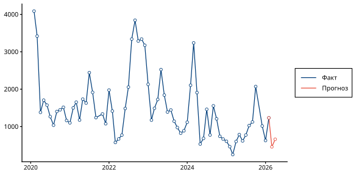

```{r}
#| include: false
#| warning: false
#| message: false

library(arrow)
library(stringi)
library(htmltools)
library(htmlwidgets)

bulletin_fo <- arrow::read_parquet("../site/data/bulletin_fo.parquet")
report_month <- stri_datetime_format(max(bulletin_fo$PERIOD), format = "LLLL yyyy", locale = "ru")

inline_charts <- isTRUE(params$inline_charts) ||
  identical(Sys.getenv("QUARTO_PROFILE"), "dist")

chart_slide <- function(rds_path, iframe_src, title) {
  # Dev: iframe → HTML. Dist / нет HTML: встраиваем RDS.
  use_inline <- inline_charts || !file.exists(iframe_src)
  if (use_inline) {
    if (!file.exists(rds_path)) {
      return(HTML(sprintf(
        '<p class="note">График не найден (%s). Запустите: quarto run presentations/scripts/export_bulletin_charts.R</p>',
        rds_path
      )))
    }
    div(class = "chart-frame-wrap chart-inline", readRDS(rds_path))
  } else {
    HTML(sprintf(
      '<div class="chart-frame-wrap"><iframe src="%s" class="chart-frame" title="%s"></iframe></div>',
      iframe_src,
      title
    ))
  }
}
```

## О чём пойдёт речь

::: {.lead}
Единая база внешней торговли России по статистике стран-партнёров: дашборд, Excel, API и чат.
:::

<div class="agenda-row">
<div><span class="ag-num">01</span><strong>Кому это нужно</strong><p>Импортёры, логистика, аналитики и банки — и какой вопрос каждый из них задаёт данным.</p></div>
<div><span class="ag-num">02</span><strong>Что собрано</strong><p>Источники, гармонизация, физические объёмы и оценка за месяцы без отчётности.</p></div>
<div><span class="ag-num">03</span><strong>Чем отличаемся</strong><p>TradeMap и UN Comtrade решают своё. Здесь — то, чего в них нет.</p></div>
<div><span class="ag-num">04</span><strong>Как получить</strong><p>Дашборд, Excel, API и «Спросить ИИ» — один срез, четыре входа.</p></div>
</div>

## {background-color="#003d7a" .section-slide}

<div class="section-number">01</div>

<div class="section-title">Зачем это понадобилось</div>

<div class="section-tagline">
Официальная таможенная статистика России перестала публиковаться в привычном виде, а решения принимать нужно.
</div>

## Что изменилось с данными внешней торговли

<div class="change-list">
<div><span>01</span><strong>Архив обрывается</strong><p>Официальная статистика ФТС в привычном виде есть за 2014–2022. Далее подробные данные не публикуются.</p></div>
<div><span>02</span><strong>Месячной детализации нет</strong><p>Оперативные данные по товарной номенклатуре больше не публикуются. При этом внешняя торговля может изменяться быстро и требовать оперативных оценок.</p></div>
<div><span>03</span><strong>Возрос спрос на данные зеркальной статистики</strong><p>Статистика стран-партнёров, UN Comtrade, коммерческие платформы. У каждой платформмы свой формат данных, особенности кодировки товаров и это также создаёт проблемы.</p></div>
</div>

::: {.concl}
Разовая выгрузка из браузера эту задачу не закрывает. Нужен регулярный сбор, сверка источников, проверка и гармонизация данных.
:::

## Что это значит на практике

:::: {.cols-2}

::: {.c}
[Если собирать самостоятельно]{.ch}

- выгрузки из разных источников в несовместимых форматах
- у каждой страны свои обозначения, единицы и сроки публикации
- ручная склейка и постоянная сверка разных источников 
- при уходе исполнителя повторить некому
:::

::: {.c}
[Что требуется на деле]{.ch}

- единая структура по всем странам и товарным кодам
- прозрачное происхождение каждой цифры
- обновление и контроль качества на регулярной основе
- возможность выгрузить срез в свой инструмент (в том числе Excel)
:::

::::

::: {.concl}
Эту работу мы берём на себя и отдаём результат в готовом виде: собранную, сверенную и гармонизированную базу с русскими названиями стран и товарных кодов.
:::

## {background-color="#003d7a" .section-slide}

<div class="section-number">02</div>

<div class="section-title">Что мы собрали</div>

<div class="section-tagline">
База внешней торговли России по данным стран-партнёров: более 7 млн строк, 141 страна, помесячно с 2019 года.
</div>

## Кому и для каких решений

:::: {.cols-3}

::: {.c}
[Импортёрам и экспортёрам]{.ch}
Оценить ёмкость рынка по конкретной товарной позиции, найти поставщиков и покупателей, увидеть, кто ещё возит этот товар и в каких объёмах.

*Вопрос:* сколько этого товара реально ввозится и из каких стран.
:::

::: {.c}
[Логистическим компаниям]{.ch}
Спрогнозировать объёмы перевозок по направлениям и видам грузов, планировать мощности под реальные тоннажи, а не под стоимостные оценки.

*Вопрос:* сколько груза пойдёт по направлению в следующем квартале.
:::

::: {.c}
[Аналитикам и банкам]{.ch}
Строить макроэкономические модели на месячных данных, оценивать импортозамещение, отслеживать отрасли с растущими физическими объёмами.

*Вопрос:* какие отрасли растут в натуральном выражении, а не в деньгах.
:::

::::

::: {.concl}
Общее у всех трёх сценариев одно: нужны месячные данные в разрезе стран и товарных кодов, причём не только в долларах, но и в натуральных единицах.
:::

## Из чего состоит платформа

<table class="plain"><thead><tr><th>Составляющая</th><th>Что это даёт</th></tr></thead><tbody><tr><td>Гармонизированная база</td><td>согласованные страны, товарные коды, периоды, стоимость и натуральные единицы в одной структуре</td></tr><tr><td>Несколько источников</td><td>национальная статистика Китая, Индии и Турции, UN Comtrade для остальных стран, архив ФТС для сверки</td></tr><tr><td>Индексы физических объёмов</td><td>динамика натуральных объёмов на уровнях 2, 4 и 6 знаков ТН ВЭД - показателя нет ни в TradeMap, ни в Comtrade</td></tr><tr><td>Оценка за неотчитавшиеся месяцы</td><td>наукаст на ансамбле моделей (факторная + SARIMA), помеченный в данных отдельным флагом</td></tr><tr><td>Доступ</td><td>дашборд, выгрузка в Excel без программирования, API для интеграции</td></tr></tbody></table>

## Как устроен сбор данных {.slide-diagram}

```{mermaid}
%%| fig-width: 11
%%| fig-height: 4.6
flowchart LR
    A["Китай · Индия · Турция<br/>национальная статистика"] --> D
    B["UN Comtrade<br/>остальные страны"] --> D
    C["Архив ФТС<br/>сверка 2014-2022"] --> D
    D["Сбор и гармонизация"] --> E
    E[("unified_trade_data<br/>более 7 млн строк")]
    E --> F["Дашборд"]
    E --> G["Excel"]
    E --> H["API"]

    classDef plain fill:#ffffff,stroke:#8a95a3,stroke-width:1px,color:#2c3e50
    class A,B,C,D,F,G,H plain
    style E fill:#ffffff,stroke:#003d7a,stroke-width:2px,color:#003d7a
```

::: {.concl}
У каждой записи сохраняется источник, из которого она пришла. Если по стране есть национальная статистика, данные Comtrade по ней не берутся - это исключает двойной счёт.
:::

## Особенности данных

<div class="feature-list">
<div><strong>Физические объёмы</strong><span>не только доллары: килограммы, штуки, литры; пропуски восстанавливаются</span></div>
<div><strong>Индексы физобъёмов</strong><span>динамика груза без влияния цен, по странам и уровням ТН ВЭД</span></div>
<div><strong>Гармонизация</strong><span>единые коды стран и согласованные единицы между источниками</span></div>
<div><strong>Наукаст</strong><span>месяцы без отчётности оценены и помечены флагом <code>TYPE = pred</code></span></div>
<div><strong>Русские названия</strong><span>коды ТН ВЭД с официальными названиями ЕАЭС или с переводом, если названия нет</span></div>
</div>

## Почему этим данным можно верить

:::: {.cols-3}

::: {.c}
[Видно происхождение]{.ch}
У каждой записи хранится источник и признак «факт или оценка». Всегда можно ответить, откуда взялась конкретная цифра и не является ли она модельной.
:::

::: {.c}
[Проверки перед публикацией]{.ch}
После каждой пересборки база проходит автоматические проверки. Если они не пройдены, версия не публикуется на дашборд.
:::

::: {.c}
[Сомнительное помечается]{.ch}
Аномальные значения не удаляются молча: они отмечаются, чтобы было видно, где показатель вызывает вопросы, а где данные надёжны.
:::

::::

::: {.concl}
Отдельно ведётся учёт того, что и когда было загружено: по каждому месяцу известно, какие страны в нём есть и какая у их выгрузки контрольная сумма. Страны правят прошлую отчётность годами, и без такого учёта незаметно разъезжаются цифры за прошлые периоды.
:::

## {background-color="#003d7a" .section-slide}

<div class="section-number">03</div>

<div class="section-title">На фоне альтернатив</div>

<div class="section-tagline">
TradeMap и UN Comtrade решают свои задачи. Мы делаем то, чего в них нет: регулярность, натуральные объёмы и программный доступ.
</div>

## Три источника и их назначение

<div class="cmp">
<div class="cmp-col">
<strong>TradeMap</strong>
<ul>
<li>справочная витрина, разовые запросы</li>
<li>HS — насколько отдаёт страна</li>
<li>натуральные объёмы частично</li>
<li>только браузер, без API</li>
</ul>
</div>
<div class="cmp-col">
<strong>UN Comtrade</strong>
<ul>
<li>глобальный архив, сырьё как есть</li>
<li>HS до 6 знаков</li>
<li>объёмы не по всем позициям</li>
<li>API есть, но с лимитами и ручной чисткой</li>
</ul>
</div>
<div class="cmp-col cmp-ours">
<strong>Наша платформа</strong>
<ul>
<li>готовая база для регулярной работы</li>
<li>ТН ВЭД до 10 знаков</li>
<li>натуральные объёмы и индексы физобъёмов</li>
<li>API, Excel и источник у каждой цифры</li>
</ul>
</div>
</div>

::: {.concl}
Comtrade мы не заменяем: где нет национальной статистики, берём его. Сборка и сверка уже сделаны.
:::

## {background-color="#003d7a" .section-slide}

<div class="section-number">04</div>

<div class="section-title">Что видно в данных</div>

<div class="section-tagline">
Три примера из ежемесячного бюллетеня: динамика натуральных объёмов, структура экспорта и оценка за последние месяцы.
</div>

## Физические объёмы торговли {.slide-chart-hero}

<div class="chart-slide-header">
<span class="chart-tag">Ежемесячный бюллетень</span>
<span class="chart-title">Изменение физобъёма год к году, %</span>
<span class="chart-period">`r report_month`</span>
</div>

<div class="insight-bar insight-bar-before-chart">
<div class="insight-item"><strong>Турция</strong> сжатие торговли с ноября 2023&nbsp;г.</div>
<div class="insight-item"><strong>Индия</strong> экспорт −12,5% г/г, в основном нефть</div>
<div class="insight-item"><strong>Китай</strong> импорт +12%, экспорт +2% по объёму</div>
</div>

```{r}
#| echo: false
#| results: asis
chart_slide(
  "figures/bulletin/fizob.rds",
  "figures/bulletin/fizob.html",
  "Физические объёмы торговли"
)
```

## Зачем нужен индекс физобъёма

:::: {.cols-3}

::: {.c}
[В чём сложность]{.ch}
Внутри одной товарной группы единицы измерения разные: литры, кубометры, штуки, киловатт-часы. Сложить их напрямую нельзя - сумма не покажет, растёт ли объём торговли.
:::

::: {.c}
[Как считается]{.ch}
Каждая позиция нормируется к своему базовому периоду, агрегируются уже безразмерные величины, скользящее окно в 12 месяцев снимает сезонность.
:::

::: {.c}
[Что это даёт]{.ch}
Ответ на вопрос «груза стало больше или меньше» - отдельно от того, подорожал он или подешевел. По любой стране и любому уровню товарного кода.
:::

::::

::: {.concl}
Стоимость в долларах смешивает цену и объём. В 2022 году экспорт вырос на 70% в долларах и одновременно сократился в тоннах - и оба числа верны.
:::

## Структура экспорта: нефтегаз и прочее {.slide-chart-hero}

<div class="chart-slide-header">
<span class="chart-tag">Структурный анализ</span>
<span class="chart-title">Экспорт в стоимостном выражении, млрд $</span>
<span class="chart-period">нефтегаз vs прочее · `r report_month`</span>
</div>

<div class="insight-bar insight-bar-before-chart insight-bar-accent">
<div class="insight-item"><strong>Китай и Индия</strong> ядро нефтегазового экспорта</div>
<div class="insight-item"><strong>Прочий экспорт</strong> своя динамика, в сумме теряется</div>
<div class="insight-item"><strong>Вопрос на 2026</strong> вернётся ли нефтегаз к уровням 2024? Пока ответ скорее положительный.</div>
</div>

```{r}
#| echo: false
#| results: asis
chart_slide(
  "figures/bulletin/oil_nonoil.rds",
  "figures/bulletin/oil_nonoil.html",
  "Нефтегаз и прочий экспорт"
)
```

## Оценка за месяцы, по которым нет отчётности {.slide-diagram}

По последним месяцам отчётности ещё нет, а решения принимаются сейчас. Эти месяцы мы оцениваем не простой экстраполяцией, а ансамблем из двух дополняющих друг друга моделей.

```{mermaid}
%%| fig-width: 11
%%| fig-height: 4.2
flowchart LR
    A["Ряды по товарным<br/>группам и направлениям"] --> B["Факторная модель DFM<br/>связи между группами,<br/>странами, направлениями"]
    A --> C["SARIMA<br/>сезонность и инерция<br/>каждого ряда"]
    B --> D["Ансамбль:<br/>усреднение прогнозов"]
    C --> D
    D --> E["Раскладка до 10 знаков,<br/>стран и физобъёмов"]
    E --> F["Оценка с флагом<br/>«факт / прогноз»"]

    classDef plain fill:#ffffff,stroke:#8a95a3,stroke-width:1px,color:#2c3e50
    class A,B,C,E,F plain
    style D fill:#ffffff,stroke:#003d7a,stroke-width:2px,color:#003d7a
```

::: {.concl}
Каждая модель ловит своё: факторная DFM - совместное движение сотен товарных потоков, SARIMA - сезонность и инерцию отдельного ряда; усреднение делает оценку устойчивее любой одной модели. Результат раскладывается до полной детализации и всегда помечен флагом.
:::

## Оценка работает и на детальном уровне {.slide-nowcast}

<div class="chart-slide-header">
<span class="chart-tag">Nowcast</span>
<span class="chart-title">Импорт напитков из Испании · ТН ВЭД 22</span>
<span class="chart-period">тонны</span>
</div>

<div class="nowcast-stage">

<div class="nowcast-read">
<p><span class="swatch fact"></span><strong>Факт</strong> — месяцы, по которым отчётность уже есть.</p>
<p><span class="swatch pred"></span><strong>Прогноз</strong> — оперативная оценка на основе существующего ансамбля моделей.</p>
<p class="nowcast-point">Наукаст масштабируется до 10 знака. При этом в самой базе данных есть флаг, что это именно оценка, а не официальная статистика.</p>
</div>
</div>

## {background-color="#003d7a" .section-slide}

<div class="section-number">05</div>

<div class="section-title">Как вы получаете данные</div>

<div class="section-tagline">
Дашборд, Excel, API и чат «Спросить ИИ» — один и тот же срез, четыре входа.
</div>

## Четыре способа под разные роли

<table class="plain"><thead><tr><th>Способ</th><th>Кому</th><th>Что нужно уметь</th></tr></thead><tbody><tr><td>Дашборд</td><td>руководителю, отраслевому аналитику</td><td>фильтры мышкой в браузере</td></tr><tr><td>Excel</td><td>аналитику в таблицах</td><td>меню «Данные», без кода</td></tr><tr><td>API</td><td>разработчику и своей системе</td><td>HTTP-запрос из Python, R или BI</td></tr><tr><td class="ours"><a href="https://nts.mgimo.ru/site/demo.html">Спросить ИИ</a></td><td>тому, кто формулирует вопрос словами</td><td>ничего: чат сам берёт срез и отдаёт Excel</td></tr></tbody></table>

::: {.concl}
Чат на <a href="https://nts.mgimo.ru/site/demo.html">nts.mgimo.ru/site/demo.html</a>: вопрос вроде «сравни экспорт нефти в Индию и Китай за 12 месяцев и выгрузи в Excel» — сводка в ответе и файл XLSX. Та же база и тот же ключ, что у дашборда и API.
:::

## Дашборд

<table class="plain"><thead><tr><th>Вкладка</th><th>На какой вопрос отвечает</th></tr></thead><tbody><tr><td>Обзор</td><td>что происходит со стоимостью и объёмом торговли в целом, включая оценку за последние месяцы</td></tr><tr><td>География</td><td>как торговля распределена по странам, в долларах и в килограммах</td></tr><tr><td>Продукты</td><td>какие товарные группы дают основной объём</td></tr><tr><td>Покрытие</td><td>по каким странам и периодам данные вообще есть</td></tr><tr><td>Физобъемы</td><td>больше или меньше стало груза, по странам и товарным группам</td></tr></tbody></table>

::: {.note}
Фильтры сгруппированы по разделам: направление торговли, год, источник, страна из 141, товарная группа из 98, единица измерения. Товар можно искать по русскому названию, а не только по коду.
:::

## Excel: подключение занимает три шага

:::: {.cols-3}

::: {.c}
[1. Личный ключ]{.ch}
В кабинете нажать «Выпустить токен» и скопировать ключ. Ключ личный, показывается один раз, при утере перевыпускается там же.
:::

::: {.c}
[2. Подключить источник]{.ch}
Данные → Получить данные → Из других источников → **Из веб-канала OData**. Вставить адрес фида, в окне входа выбрать «Основной»: имя любое, пароль - ваш ключ.
:::

::: {.c}
[3. Выбрать таблицу]{.ch}
В навигаторе две таблицы: `trade` - стоимость, вес и количество, `fizob` - индекс физического объёма. Нажать **«Преобразовать данные»**, а не «Загрузить».
:::

::::

::: {.concl}
Дальше Excel работает как с обычной таблицей. Формулы и макросы не нужны, всё делается через меню. Готовый файл с уже настроенным подключением и отдельным ключом мы пришлём заранее, чтобы ваши аналитики меняли срез и получали данные прямо во время встречи.
:::

## Срез ставится мышкой, обновляется кнопкой

:::: {.cols-2}

::: {.c}
[Фильтры в редакторе запроса]{.ch}
Стрелка в заголовке столбца:

- `STRANA` - страна по ISO-коду: `CN`, `TR`, `DE`
- `PERIOD` - период: после даты или диапазон
- `NAPR` - направление: `ИМ` или `ЭК`
- `TNVED2`, `TNVED4` - товарная группа
:::

::: {.c}
[Дальше]{.ch}
Отбор идёт на сервере, в файл приезжает только нужный срез:

- «Обновить всё» - свежие данные по тем же фильтрам
- сменить срез можно правкой шага фильтра
- сводные таблицы и графики поверх продолжают работать
:::

::::

::: {.note}
Фильтр обязателен: в базе миллионы строк, и без отбора Excel будет тянуть всё. Это единственное, что нужно запомнить при первом подключении.
:::

## Что приходит в Excel

<table class="plain"><thead><tr><th>Поле</th><th>Что означает</th><th>Как использовать</th></tr></thead><tbody><tr><td>STOIM</td><td>стоимость, доллары США</td><td>складывается без ограничений</td></tr><tr><td>NETTO</td><td>вес нетто, килограммы</td><td>складывается без ограничений</td></tr><tr><td>KOL и EDIZM</td><td>количество и его единица измерения</td><td>суммируется только внутри одной единицы</td></tr><tr><td>TNVED_NAME</td><td>название товара по-русски</td><td>приходит рядом с кодом</td></tr><tr><td>SOURCE и TYPE</td><td>источник и признак «факт или оценка»</td><td>видно, где наукаст</td></tr><tr><td>idx</td><td>индекс физобъёма в таблице fizob</td><td>динамика без влияния цен</td></tr></tbody></table>

::: {.concl}
Названия товаров приходят вместе с данными. Вести у себя справочник ТН ВЭД и сопоставлять коды вручную не нужно.
:::

## API для интеграции

:::: {.cols-2}

::: {.c}
[Два формата на выбор]{.ch}
REST с JSON и CSV - для скриптов на Python и R. OData-фид - для Excel и Power BI без единой строки кода. Авторизация в обоих случаях одним и тем же личным ключом.

Интерактивная документация со схемой всех параметров открывается в браузере.
:::

::: {.c}
[Фильтрация и агрегация на сервере]{.ch}
Страна, направление, период, уровень товарного кода, единица измерения. Можно запросить готовые суммы в нужном разрезе, а не выкачивать сырые строки и агрегировать у себя.

Справочники стран и кодов ТН ВЭД с русскими названиями отдаются отдельными запросами - для выпадающих списков в вашем интерфейсе.
:::

::::

::: {.note}
Сейчас API работает в пилотном режиме: доступ выдаётся по согласованию и ограничен на уровне сети.
:::

## Данные для ИИ-агента {.tight}

::: {.lead}
Без базы модель уверенно выдумает, сколько нефти ушло в Индию. С базой она называет цифру из выгрузки.
:::

:::: {.cols-2}

::: {.c}
[Вопрос словами]{.ch}
«На сколько выросли удобрения в Индию», «кто ещё возит этот товар», «какие группы просели в тоннах». Коды, страну и период агент подбирает сам.
:::

::: {.c}
[Цифра проверяется]{.ch}
Ответ строится из среза базы, а не из памяти модели. Рядом приходят источник и флаг «факт или оценка», поэтому прогноз не выдаётся за отчётность.
:::

::::

::: {.concl}
Готовый чат — <a href="https://nts.mgimo.ru/site/demo.html">«Спросить ИИ»</a>. Тот же доступ есть у своего агента через MCP: <a href="https://nts.mgimo.ru/mcp">nts.mgimo.ru/mcp</a>.
:::

## Как агент получает данные {.tight}

<ol class="numbered"><li>Агенту описывают <strong>один инструмент</strong>: адрес сервиса, ключ и перечень параметров. Отдельная интеграция под каждый новый вопрос не нужна.</li><li>Он уточняет коды по справочникам: «Китай» превращается в <code>CN</code>, «удобрения» в группу <code>31</code>. Коды берутся из ответа сервиса, а не угадываются моделью.</li><li>Запрашивает <strong>уже агрегированный срез</strong>. Это решающий пункт: сырые данные за один месяц по одной стране это десятки тысяч строк, они не помещаются в модель и дорого обходятся. Готовая сумма в нужном разрезе укладывается в пару десятков строк.</li><li>Получает JSON и формулирует ответ, ссылаясь на цифры и на их происхождение.</li></ol>

::: {.concl}
Чего агент не делает: он не выбирает за вас метрику и не объясняет, почему цифра изменилась. На вопрос «выросла ли торговля» он ответит в долларах, хотя в тоннах картина может оказаться обратной. Вопрос по-прежнему ставит человек.
:::

## Условия доступа

:::: {.cols-3}

::: {.c}
[Сейчас: пилот, бесплатно]{.ch}
На период пилотной эксплуатации доступ предоставляется бесплатно - дашборд, выгрузка в Excel и API. Ограничения на этом этапе щадящие: месячной квоты нет.
:::

::: {.c}
[Дальше: коммерческий доступ]{.ch}
После пилота предполагается платный доступ. Бесплатный уровень сохранится, но с ограниченными лимитами по частоте запросов, месячному объёму и размеру выгрузки. Условия определяются.
:::

::: {.c}
[Без неожиданностей]{.ch}
Лимиты не наступают внезапно: текущий план и остаток месячной квоты видны в самом API. При исчерпании сервис отвечает понятной ошибкой с указанием, когда можно повторить запрос.
:::

::::

::: {.concl}
Пилот - возможность проверить данные на своих задачах до всяких обязательств: взять свой срез, сверить с тем, что вы знаете о рынке, и уже потом решать.
:::

## {background-color="#003d7a" .center-slide}

<div class="continue-note">
<span class="continue-title">С чего начать</span>
На период пилота доступ бесплатный: дашборд, Excel и API 
Салихов Марсель - m_salihov@fief.ru

</div>

<div class="cta-row"><div><span class="cta-num">1</span>Называете страны и товарные группы, которые вам интересны</div><div><span class="cta-num">2</span>Присылаем Excel-файл с этим срезом и личный ключ</div><div><span class="cta-num">3</span>Обновляете данные кнопкой и решаете, нужен ли доступ дальше</div></div>
