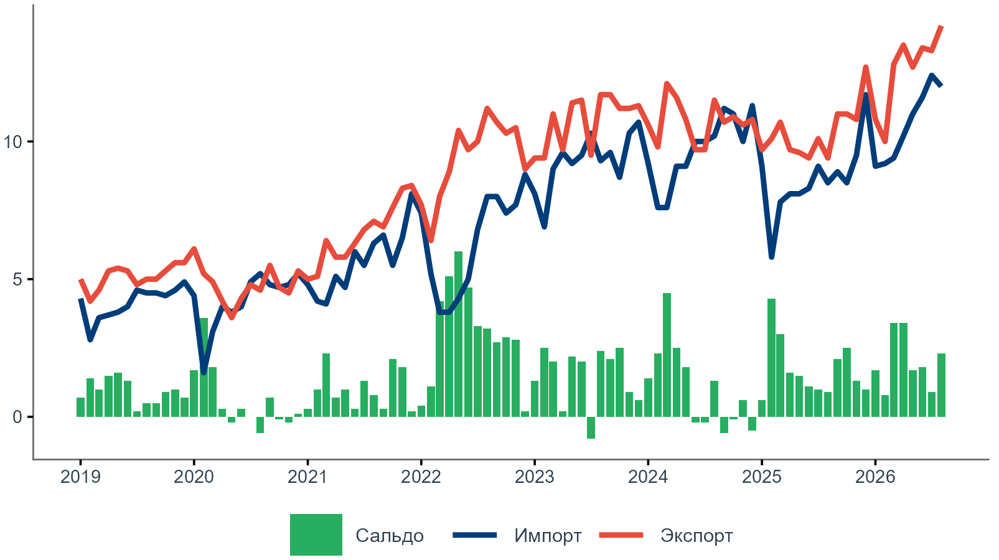
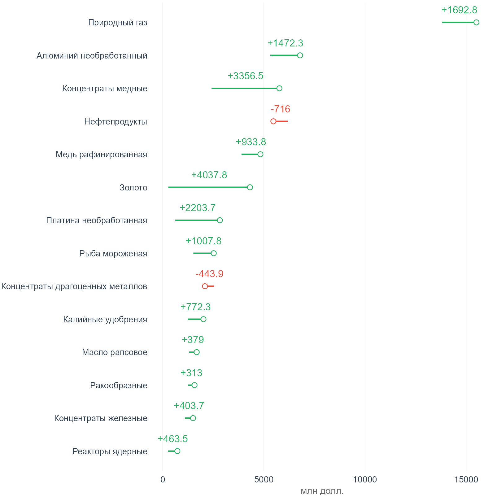

<div class="title-lead">
Актуальные данные о внешней торговле России на основе первичной статистики стран-партнёров и UN Comtrade. Мы приводим данные к единой структуре, обновляем базу каждый месяц, рассчитываем индексы физических объёмов и оперативные оценки торговли по мере публикации статистики.
</div>

<div class="hero-chips">
<span class="chip">Китай, Индия, Турция + 138 стран</span>
<span class="chip">данные с 2019 года</span>
<span class="chip">обновление ежемесячно</span>
<span class="chip">физические объёмы и оперативный прогноз</span>
<a class="chip" href="#access-formats">Доступ: ИИ-чат, Excel, дашборды, API и SQL →</a>
</div>

```{=html}
<div class="hero-logos">


</div>
```

## Примеры аналитики

На основе базы мы выпускаем ежемесячный бюллетень, считаем индексы физических объёмов и разбираем структуру экспорта.

<div class="analytics-preview">

<div class="analytics-card">
<span class="chart-tag">Ежемесячный бюллетень</span>
<strong>Экспорт, импорт и торговое сальдо: Китай</strong>

</div>

<div class="analytics-card">
<span class="chart-tag">Структурный анализ</span>
<strong>Товарные группы: изменение экспорта в Китай</strong>

</div>

</div>

[Смотреть полный ежемесячный бюллетень →](bulletin_comparison.qmd){.btn .btn-primary .landing-cta}

### Выпуски по странам

Кроме сводного обзора выходит отдельный бюллетень по каждой стране. Внутри: ключевые цифры месяца и торговое сальдо, изменение экспорта и импорта по товарным категориям за последние 12 месяцев и страница с объяснением показателей обычными словами, без специальной подготовки.

<div class="feature-highlights">
<div class="highlight-item"><strong>Китай</strong><span>Крупнейший партнёр: экспорт энергоносителей и металлов, импорт машин, электроники и транспорта.</span><a href="country_bulletins/china/bulletin_china_pdf.html">Свежий выпуск</a></div>
<div class="highlight-item"><strong>Индия</strong><span>Экспорт почти целиком нефть и нефтепродукты, сальдо с большим перевесом в пользу России.</span><a href="country_bulletins/india/bulletin_india_pdf.html">Свежий выпуск</a></div>
<div class="highlight-item"><strong>Турция</strong><span>Данные собираются напрямую из BI-портала ТУИК на уровне 12-значных товарных кодов.</span><a href="country_bulletins/turkey/bulletin_turkey_pdf.html">Свежий выпуск</a></div>
</div>

Выпуски обновляются вместе с базой. Нужен бюллетень по другой стране или в своём разрезе, [напишите нам](mailto:m_salihov@fief.ru).

## Зачем это нужно

Оценка рынков, планирование поставок и анализ рисков опираются на свежие данные о внешней торговле - по конкретным товарам и странам, а не только по общим итогам. В готовом виде таких данных нет: их приходится собирать из разных национальных источников, у каждого из которых своя структура, свои единицы измерения и свои сроки публикации.

Свести всё это вручную - самостоятельная и трудоёмкая работа: согласовать классификации, перевести единицы и названия, ежемесячно обновлять данные и следить за их качеством. Эту работу мы берём на себя и отдаём результат в готовом виде.

<div class="split-panels">

<div class="split-panel negative">
<span class="panel-label">Собирать самостоятельно</span>
<h3>Много ручной работы</h3>
<ul>
<li>выгрузки из разных источников в несовместимых форматах</li>
<li>у каждой страны свои обозначения и единицы</li>
<li>разные сроки публикации и классификации</li>
<li>постоянная сверка и риск ошибок</li>
</ul>
</div>

<div class="split-divider"></div>

<div class="split-panel positive">
<span class="panel-label">Использовать готовую базу</span>
<h3>Данные сразу пригодны для анализа</h3>
<ul>
<li>единая структура по всем странам и товарам</li>
<li>единицы измерения в российском стандарте</li>
<li>русские названия товарных кодов</li>
<li>обновление и контроль качества - на нашей стороне</li>
</ul>
</div>

</div>

## Единая база данных

В основе проекта - база внешней торговли России, собранная из статистики стран-партнёров и дополненная международными данными для полноты картины. Оперативные и детализированные данные поступают из трёх стран: Китая, Индии и Турции. В дальнейшем мы планируем расширять перечень национальных источников.

<div class="db-stats">
<div class="db-stat db-stat-main">
<span class="db-stat-value">7,4 млн</span>
<span class="db-stat-label">строк · январь 2019 - сентябрь 2026</span>
</div>
<div class="db-stat">
<span class="db-stat-value">138</span>
<span class="db-stat-label">стран из базы ООН (Comtrade)</span>
</div>
</div>

<div class="db-stats-national">
<span class="db-stats-title">Национальные источники - статистика стран-партнёров</span>
<div class="db-stats-row">
<span><strong>Индия</strong> - 569 тыс.</span>
<span><strong>Китай</strong> - 501 тыс.</span>
<span><strong>Турция</strong> - 337 тыс.</span>
</div>
</div>

<div class="slide-takeaway">
Для каждой записи сохраняется источник: видно, из национальной статистики какой страны или из какой международной базы получено значение. Полный перечень полей - на странице [«Модель данных»](data-model.qmd), а как устроены сбор и приведение к единому виду - на странице [«Методология»](technical.qmd).
</div>

## Чего нет у других сервисов

Два показателя, которые сложно найти в готовом виде где-либо ещё.

<div class="feature-grid">

<div class="feature-card accent">
<strong>Физические объёмы</strong>
Торговлю обычно оценивают в стоимостном выражении, однако такие данные не позволяют отделить изменение физических объёмов от изменения цен. Мы восстанавливаем объёмы в натуральном выражении - тонны, штуки, кубометры - и строим по ним индексы на разных уровнях товарных групп. Это позволяет отделить рост цен от роста поставок.
</div>

<div class="feature-card accent">
<strong>Оперативный прогноз (nowcast)</strong>
Национальная статистика выходит с задержкой в несколько месяцев. Чтобы не ждать, мы оцениваем торговлю за последние месяцы статистической моделью. Такие оценки всегда помечены отдельным флагом - их видно и легко отделить от фактических данных.
</div>

</div>

## Форматы доступа {#access-formats}

<div class="feature-grid">

<div class="feature-card accent">
<strong>Чат с ИИ-агентом</strong>
Задайте вопрос о внешней торговле обычным языком. Ассистент подберёт данные и ответит числами, таблицей и аналитическим комментарием. [Попробовать на сайте →](demo.qmd) · [Подключить внешнего агента через MCP →](mcp.qmd)
</div>

<div class="feature-card">
<strong>Интерактивные дашборды</strong>
Исследуйте графики и отчёты с фильтрами по товарам, странам и периодам. Готовые представления можно настроить под конкретную задачу. [Открыть дашборды →](https://nts.mgimo.ru/superset/)
</div>

<div class="feature-card">
<strong>Доступ через Excel</strong>
Подключите данные к своей книге через Power Query и обновляйте их кнопкой «Обновить всё», сохраняя структуру расчётов. [Инструкция по подключению →](https://github.com/quantviews/mgimo-foreign-trade/blob/main/docs/api-excel-guide.md). Для разовой работы попросите [ИИ-чат](demo.qmd) подготовить XLSX-файл.
</div>

<div class="feature-card">
<strong>Доступ по API и SQL</strong>
Загружайте данные напрямую в свои скрипты и расчёты через API. Для работы с базой через SQL доступ предоставляется отдельно. [Доступ по API →](api.qmd) · [Запросить доступ к базе →](mailto:m_salihov@fief.ru)
</div>

<div class="feature-card">
<strong>Выгрузка базы</strong>
Получите срез за нужные периоды, по выбранным странам и товарам, со стоимостью, массой и количеством в исходных единицах. Выгрузку готовят наши аналитики по отдельному запросу. [Обсудить задачу →](mailto:m_salihov@fief.ru)
</div>

</div>

## Доступ по API

Для регулярной работы данные можно забирать программно: они приходят прямо в Excel, Power BI или ваши скрипты, обновляются по кнопке и не требуют ручных выгрузок. Доступ работает по персональному ключу.

### Две таблицы

<div class="feature-grid">

<div class="feature-card">
<strong>Торговля</strong>
Строки внешней торговли: период, страна-партнёр, код ТН ВЭД, направление, стоимость в долларах, вес нетто в килограммах и количество в дополнительной единице. Рядом с кодами - русские названия товаров, поэтому вести собственный справочник ТН ВЭД не нужно.
<span class="chip">стоимость · вес · количество</span>
</div>

<div class="feature-card">
<strong>Индексы физических объёмов</strong>
Динамика натуральных объёмов, очищенная от изменения цен, на уровнях 2, 4 и 6 знаков ТН ВЭД и в целом по стране. Показателя в таком виде нет ни в TradeMap, ни в UN Comtrade.
<span class="chip">по странам и товарным группам</span>
</div>

</div>

У каждой строки сохраняется источник и признак «факт или модельная оценка», поэтому оперативный прогноз всегда можно отделить от отчётных данных.

### Подключение в Excel - три шага, без программирования

<div class="cta-steps">

<div class="cta-step">
<span class="cta-num">1</span>
<strong>Получить ключ</strong>
<p>В личном кабинете нажать «Выпустить токен». Ключ личный и показывается один раз; при утере перевыпускается там же.</p>
</div>

<div class="cta-step">
<span class="cta-num">2</span>
<strong>Подключить источник</strong>
<p>Данные → Получить данные → Из других источников → «Из веб-канала OData». В окне входа выбрать «Основной»: имя любое, пароль - ваш ключ.</p>
</div>

<div class="cta-step">
<span class="cta-num">3</span>
<strong>Отфильтровать и загрузить</strong>
<p>Выбрать таблицу, поставить фильтры по стране, периоду и товару мышкой и нажать «Закрыть и загрузить».</p>
</div>

</div>

Дальше это обычная таблица Excel: поверх неё работают сводные таблицы и графики, а кнопка «Обновить всё» подтягивает свежие данные по тем же фильтрам. Отбор выполняется на нашей стороне, поэтому в файл приезжает только нужный срез, а не вся база. Полная инструкция со скриншотами - [в документации проекта](https://github.com/quantviews/mgimo-foreign-trade/blob/main/docs/api-excel-guide.md).

### Для разработчиков

<div class="feature-grid">

<div class="feature-card">
<strong>REST и OData</strong>
JSON и CSV для скриптов на Python и R, OData-фид для Excel и Power BI. Авторизация в обоих случаях одним и тем же ключом. Интерактивная схема со всеми параметрами открывается в браузере.
</div>

<div class="feature-card">
<strong>Фильтрация и агрегация на сервере</strong>
Страна, направление, период, уровень товарного кода, единица измерения. Можно запросить готовые суммы в нужном разрезе, а не выкачивать сырые строки и агрегировать у себя.
</div>

<div class="feature-card">
<strong>Справочники в комплекте</strong>
Списки стран и кодов ТН ВЭД с русскими названиями отдаются отдельными запросами - чтобы наполнить выпадающие списки в вашем интерфейсе.
</div>

</div>

### Доступ через ИИ-агентов (MCP)

Данные можно подключить к ИИ напрямую через MCP-сервер: агент сам вызывает нужные инструменты (свежие цифры, справочники, срезы торговли, индексы физобъёмов), а вы задаёте вопросы обычным языком.

<div class="feature-grid">

<div class="feature-card accent">
<strong>Удалённый сервер</strong>
Готовый адрес [nts.mgimo.ru/mcp](https://nts.mgimo.ru/mcp): подключается по персональному ключу, устанавливать ничего не нужно. Работает с Claude (десктоп, веб и мобильное приложение), ChatGPT, Cursor, VS Code и вашими агентами.
</div>

<div class="feature-card">
<strong>Локальный вариант</strong>
Тот же сервер можно запустить у себя (stdio), если ключ не хочется указывать в облачных конфигурациях.
</div>

</div>

Пошаговая настройка клиентов - на странице [«Подключение ИИ-агентов (MCP)»](mcp.qmd).

### Тарифы

На период пилотной эксплуатации доступ предоставляется бесплатно. В дальнейшем предполагается платный доступ; бесплатный уровень сохранится, но с ограничениями по частоте запросов, месячному объёму и размеру одной выгрузки.

Лимиты не наступают внезапно: текущий план и остаток месячного объёма видны в самом API, а при исчерпании сервис отвечает понятной ошибкой с указанием, когда можно повторить запрос.

::: {.callout-note}
## Как получить доступ
Ключ выдаётся вместе с адресом сервиса после согласования - [напишите нам](mailto:m_salihov@fief.ru), указав интересующие страны и товарные группы. Технический справочник по всем эндпоинтам и параметрам - [в документации проекта](https://github.com/quantviews/mgimo-foreign-trade/blob/main/docs/api-reference.md).
:::

## В сравнении с альтернативами

Для обзорных запросов есть привычные веб-инструменты - TradeMap и UN Comtrade. Для регулярной аналитики и автоматизации они быстро упираются в ограничения.

<div class="source-grid">

<div class="source-card highlight">
<div class="card-logos">


</div>
<span class="tag">Наш проект</span>
<div class="card-title">МГИМО / ИЭФ</div>
<div class="card-body">Готовая база для регулярного анализа внешней торговли России.</div>
<div class="card-spec">
Россия и её партнёры, помесячная детализация, Китай, Индия и Турция плюс данные ООН. У каждой записи видно происхождение.
</div>
<ul class="card-list">
<li>единый вид данных из разных стран</li>
<li>русские названия и привычные единицы</li>
<li>физобъёмы и индексы объёмов</li>
<li>оперативный прогноз и дашборды</li>
</ul>
<div class="card-verdict">Для регулярной аналитики</div>
</div>

<div class="source-card">
<span class="tag">Веб-платформа</span>
<div class="card-title">TradeMap</div>
<div class="card-body">Справочная витрина Международного торгового центра (ITC).</div>
<div class="card-spec">
Товарные коды до 6 знаков, стоимость в долларах, без подробной национальной номенклатуры. Источник данных и результаты их проверки не всегда прозрачны.
</div>
<ul class="card-list">
<li>только браузер, без автоматизации</li>
<li>лимиты на выгрузку</li>
<li>источники не сведены к единому виду</li>
<li>нет физобъёмов и прогноза</li>
</ul>
<div class="card-verdict weak">Для разовых запросов</div>
</div>

<div class="source-card">
<span class="tag">Международный архив</span>
<div class="card-title">UN Comtrade</div>
<div class="card-body">Глобальный архив первичной внешнеторговой статистики ООН.</div>
<div class="card-spec">
Данные по 200+ странам. Физические объёмы есть не по всем позициям, форматы и сроки различаются, ошибки в исходных данных не исправляются.
</div>
<ul class="card-list">
<li>ограничения и задержки доступа</li>
<li>разные форматы и сроки</li>
<li>требуется ручная сверка</li>
<li>нет готовой аналитики</li>
</ul>
<div class="card-verdict mid">Не готовое решение</div>
</div>

</div>

<table class="compare-table">
<thead>
<tr>
<th class="col-criterion"></th>
<th class="col-us">МГИМО / ИЭФ</th>
<th class="col-them">TradeMap</th>
</tr>
</thead>
<tbody>
<tr class="group-row"><td colspan="3">Доступ</td></tr>
<tr>
<td class="criterion">Автоматизация и API</td>
<td class="cell-us"><span class="mark-yes">✓</span> доступ по API</td>
<td class="cell-no"><span class="mark-no">✗</span> только браузер</td>
</tr>
<tr>
<td class="criterion">Массовые выгрузки</td>
<td class="cell-us"><span class="mark-yes">✓</span> без ограничений</td>
<td class="cell-no">лимиты интерфейса</td>
</tr>
<tr class="group-row"><td colspan="3">Данные</td></tr>
<tr>
<td class="criterion">Единый формат данных</td>
<td class="cell-us"><span class="mark-yes">✓</span> все страны в одном стандарте</td>
<td class="cell-mid">частично</td>
</tr>
<tr>
<td class="criterion">Детализация товаров</td>
<td class="cell-us">коды 2–10 знаков</td>
<td class="cell-mid">коды до 6 знаков</td>
</tr>
<tr>
<td class="criterion">Русские названия и единицы</td>
<td class="cell-us"><span class="mark-yes">✓</span> российский стандарт</td>
<td class="cell-no"><span class="mark-no">✗</span></td>
</tr>
<tr>
<td class="criterion">Физические объёмы</td>
<td class="cell-us"><span class="mark-yes">✓</span> + индексы физобъёмов</td>
<td class="cell-mid">частично</td>
</tr>
<tr>
<td class="criterion">Указан источник данных</td>
<td class="cell-us"><span class="mark-yes">✓</span> у каждой записи</td>
<td class="cell-no"><span class="mark-no">✗</span></td>
</tr>
<tr class="group-row"><td colspan="3">Аналитика</td></tr>
<tr>
<td class="criterion">Дашборды и отчёты</td>
<td class="cell-us"><span class="mark-yes">✓</span> дашборды и отчёты</td>
<td class="cell-mid">базовые графики</td>
</tr>
<tr>
<td class="criterion">Оперативный прогноз</td>
<td class="cell-us"><span class="mark-yes">✓</span> nowcast</td>
<td class="cell-no"><span class="mark-no">✗</span></td>
</tr>
</tbody>
</table>

## Как начать

<div class="cta-steps">

<div class="cta-step">
<span class="cta-num">1</span>
<strong>Свяжитесь с командой</strong>
<p>Укажите интересующие страны, товары и желаемый формат данных.</p>
<p class="cta-email"><a href="mailto:m_salihov@fief.ru">m_salihov@fief.ru</a></p>
</div>

<div class="cta-step">
<span class="cta-num">2</span>
<strong>Тестовый доступ</strong>
<p>На этапе запуска предоставляется бесплатно.</p>
</div>

<div class="cta-step">
<span class="cta-num">3</span>
<strong>Внедрение</strong>
<p>Помогаем встроить данные в ваши процессы и аналитику.</p>
</div>

</div>

